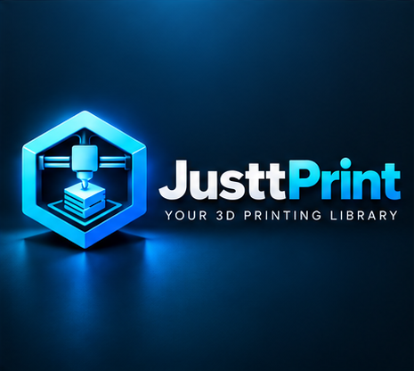
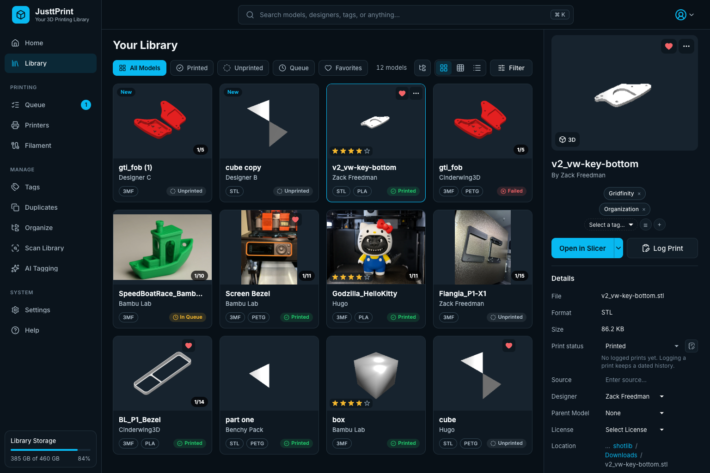
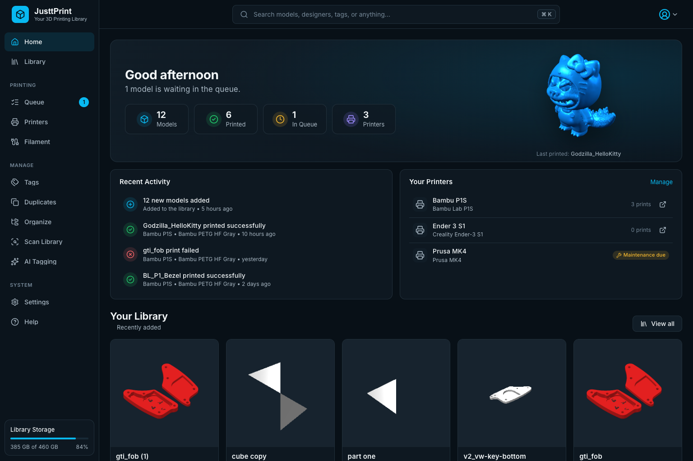
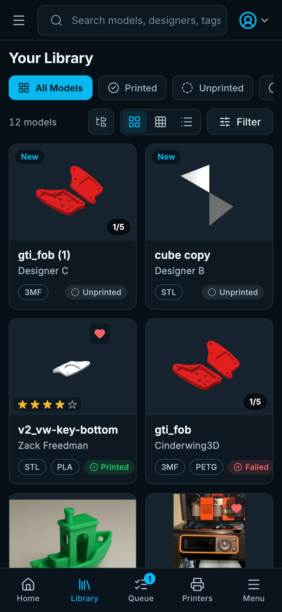

# JusttPrint



**Version 8.4.0**

JusttPrint is a self-hosted web app for your 3D printing model collection. It runs in Docker on a NAS, home server or PC, and you use it from any browser on your network, including phones and tablets.



## Features

- **A home for your printing**: Home shows your figures, recent prints and printers, the kits you are partway through, what needs attention (models without tags, a license, a category or a thumbnail, duplicates, maintenance, late backups), your favorites, collections and categories; the Library has tabs for Printed, Unprinted, Queue and Favorites
- **Print queue and printers** pages: what is printing and up next, and your printers with their web pages and maintenance reminders
- **What runs in the background**: above Library Storage, a progress bar for each job while it runs (library scans, AI Tagging, Categorize Library, thumbnails, duplicate checks, site downloads, uploads, backups, Organize and Tidy), with how far it is and how long it should still take; nothing when nothing runs
- **Notifications**: a bell for what finished or went wrong in the background (new models from scans, thumbnail and AI tagging jobs, maintenance coming due, failed backups), each person seeing what their role may
- **Light or dark**: each person picks a dark or light look, or follows their computer's setting, and an accent color
- **Works on phones and tablets**: a bottom bar and full-screen details on phones, an icon rail on tablets, finger-sized controls on touch screens, and **Install App** for the home screen (Android and desktop need HTTPS)
- **Automatic scanning** of STL, 3MF, ZIP and other model files, with thumbnails rendered by the JusttPrint backend; large pictures show as small copies in the grid, and the originals are kept; files moved to another folder or share outside JusttPrint keep their tags, notes and print history
- **Upload from the browser**: drop model files on the page (or use **Upload** in the Library) to save them into a library folder; large files (many GB) go in pieces that resume after a lost connection
- **Upload folder and Organize**: uploads wait in an Upload folder you choose, marked **Not organized**; one click on **Organize** gives each its Category and Subcategory (the site's, the AI's or from its names), moves it to `Category/Subcategory/Title/`, names its files after its Title, puts pictures and documents in place and AI-tags it, all set up under **Settings → Scanning → Organize**
- **A folder for every model**: uploads and site downloads go into a folder named after the model, with its pictures in `image/`, videos in `video/` and documents in `document/`; the model's page shows them, plays the videos and reads PDFs, Word, Markdown and text files in the page, and you choose the cover picture; **Tidy Into Model Folders** gives models already in the library folders of their own
- **Add from links**: paste a list of Printables, Thingiverse or MakerWorld links and each model is added with its name, designer, license, picture and source link, and its files downloaded into the library when you want (Thingiverse with your own API token); links already in the library are skipped
- **Same-geometry duplicates**: besides identical files, the Duplicates page finds the same model saved as different files (an STL and its 3MF, a re-export), also inside ZIP files, and the same design exported at another mesh resolution
- **MakerWorld, Printables and Thingiverse details and downloads**: MakerWorld models show their English title, print profile (plates, print time, filament by color), files with English names and video in the details panel, and download as a 3MF into a library folder after a one-time MakerWorld sign-in; Printables and Thingiverse models show their popularity and rating, what they are a remix of, print settings, the printer and settings each G-code file was sliced for, and their files to download
- **Several people at once**: edits show up live in every open browser, and two people editing the same field are asked whose version stays instead of one silently overwriting the other
- **User accounts** for family or a makerspace: admins, editors who manage the library, and viewers who browse and download; optional **guest access** to browse without an account
- **A page for every model**: **Open** shows a model on its own page with large pictures, its description, the site's print profile, videos, documents, notes and the other files in its folder with a 3D view right on the page; the details sidebar shows the same sections in one column, and can be turned off so a click opens the page
- **Edit everything in one place**: the **Edit** dialog changes a model's name (renaming its file), designer, source, title, license, tags, categories, rating and notes at once, and for models from MakerWorld, Printables or Thingiverse also the site's title, description, tags and print profile names
- **Categories**: every model has one place, a Category and a Subcategory (Art › Sculptures, Toys & Games › Puzzles…) from MakerWorld's list of 11 categories and their subcategories; MakerWorld models bring theirs, and the AI service places the rest from each model's picture, in **Categorize Library** and in every AI Tagging run
- **Folders as models and kit progress**: show each folder of model files as one model with a page of its own; tick off a kit's parts (a 3MF's plates, a folder's files) as you print them
- **Assembly view**: a folder's parts in one 3D scene, as designed or laid out, moved and turned and saved
- **History**: upload a new version of a model and keep the old file; every change to every model's details listed in one place, with a way back
- **Collections**: group models from any folders into projects, gift lists or spare-part sets, and **smart collections** that keep a search and always show what it finds
- **Search by meaning, with a photo, and More like this**: the AI service finds related words or tells what a photo shows; models with a similar shape at any size
- **Typed search**: `tag:robot creator:"M Armory" -tag:broken (category:Toys OR category:Art) is:unprinted rating:4+` in the search box
- **Notes in English**: notes in another language get an English translation, and new models' notes are saved in English with the original kept; translated by Google Cloud Translation (with a warning before its 500,000 free characters a month run out), the free MyMemory service or your AI service, in the order you choose
- **Share links and QR codes**: a read-only page for a model or a collection that opens without an account, with a 3D view, optional downloads and an expiry date
- **Statistics**: prints per month, success rate, top designers, most printed models and printers
- **3D preview** of single models or every part in a folder or ZIP bundle
- **Tags, designers, licenses, notes and source links** for every model
- **Print status and history**: Unprinted, Want, Queued, Printing, Printed, Failed, with dated print logs
- **Search and filters** by name, folder, tag, designer, category, status and more
- **Edit mode and groups**: **Edit** next to Filter turns cards into choices: one model shows its details, more open Multi-edit to change them all at once; **Create Group** keeps models together under a name (with name suggestions), groups go inside groups, and a group card opens the group's own page
- **Undo** for metadata and tag edits, for renaming, merging and deleting tags, and for the Metadata Editor's renames, merges and clears: the Undo button after a change, or Ctrl/⌘ Z for the last 20
- **Duplicate finder** based on file contents
- **AI tagging** with OpenAI, Claude, Gemini, Puter or a local server such as Ollama; runs keep going in the background, with progress in every browser
- **MCP server** so AI agents can search and update your library, and add models from links
- **Open in OrcaSlicer** with one click, nothing to install besides OrcaSlicer; other slicers through a small helper on your computer
- **Backup and restore** of the library database from the browser, and **automatic backups** on a schedule
- **Print Roulette** to pick a random model

See [GUIDE.md](docs/GUIDE.md) for how to use each feature and [CHANGELOG.md](CHANGELOG.md) for what changed.

| Home | On a phone |
|------|------------|
|  |  |

<a id="server-mode"></a>

## Quick Start

You need [Docker](https://www.docker.com/get-started) (Docker Desktop on Windows and Mac).

1. Create a folder for JusttPrint, for example `justtprint`, and open a terminal in it.
2. Create a file named `docker-compose.yml` in that folder with this content. Change the two lines marked `CHANGE`:

   ```yaml
   services:
     justtprint:
       image: ace2123/justtprint:latest
       container_name: justtprint-server
       ports:
         - "5000:5000"
       volumes:
         - ./data:/root/.config/justtprint
         - /path/to/your/models:/mnt/models:ro     # CHANGE: your models folder
       environment:
         - STL_HOME=/mnt/models
         - JUSTTPRINT_PASSWORD=choose-a-password   # CHANGE: your login password
         - PUID=1000
         - PGID=1000
       restart: unless-stopped
       mem_limit: 8g
       mem_reservation: 1g
   ```

3. Start it:

   ```bash
   docker compose up -d
   ```

4. Open `http://<docker-host-ip>:5000` (or `http://localhost:5000` on the same computer) and log in with your password.

JusttPrint scans `/mnt/models` right away and then every 60 minutes. Thumbnails are made in the background.

## Docker Run

If you prefer one command instead of a Compose file:

```bash
docker run -d --name justtprint-server \
  -p 5000:5000 \
  -v ./data:/root/.config/justtprint \
  -v /path/to/your/models:/mnt/models:ro \
  -e STL_HOME=/mnt/models \
  -e JUSTTPRINT_PASSWORD='choose-a-password' \
  --memory 8g \
  --restart unless-stopped \
  ace2123/justtprint:latest
```

On Windows, write the models path like `C:/Users/you/Models:/mnt/models:ro`.

## Unraid

JusttPrint has an Unraid template ([unraid/justtprint.xml](unraid/justtprint.xml)).

1. In Unraid, open **Docker**, scroll to **Template Repositories**, add `https://github.com/ngolston/JusttPrint` and click **Save**.
2. Click **Add Container** and choose **JusttPrint** under **Template**.
3. Choose a **Password** and click **Apply**. App Data goes to `/mnt/user/appdata/justtprint`.
4. Click **WebUI** in the container's menu and log in as `admin`. JusttPrint lists `/mnt/user` and your shares in it: tick the ones that hold your models and click **Scan**.

Don't install it by searching for JusttPrint under **Apps** and choosing the Docker Hub result: Unraid then builds a form from the image alone, without the folders, the password or the other settings. If **Template Repositories** is not there, download the template in the Unraid terminal and pick **JusttPrint** under **User templates** in step 2:

```bash
wget -O /boot/config/plugins/dockerMan/templates-user/my-JusttPrint.xml https://raw.githubusercontent.com/ngolston/JusttPrint/main/unraid/justtprint.xml
```

**Unraid Shares** maps `/mnt/user` into the container at the same path, read and write, so delete, move and Organize work and folders keep the paths you know. Add or change model folders any time under **Settings → Scanning → STL Home**. Unraid's own shares (`appdata`, `system`, `domains`, `isos`) are never shown or scanned. To keep JusttPrint to one share, set both the host and the container path of **Unraid Shares** to it (for example `/mnt/user/models`). Moving a library from an older **Models** mapping (`/mnt/models`) to **Unraid Shares** keeps each model's details: replace the path in the container, then in **Settings → Scanning → STL Home** swap `/mnt/models` for the folder's `/mnt/user/...` path and save; the scan moves each model to its new path.

More settings (ZIP files, AI tagging, backups, reverse proxy) are under **Show more settings**; leave one empty to set it in the web UI instead. For NVIDIA thumbnails, see the template's description.

## Docker Compose options explained

| Option | What it does |
|--------|--------------|
| `image` | The JusttPrint image from Docker Hub. `latest` is the newest release; use a version such as `ace2123/justtprint:5.0.0` to stay on one. Works on Intel/AMD and ARM. |
| `container_name` | A fixed name, so commands like `docker logs justtprint-server` work. |
| `ports` | `host:container`. Open the app at the host port. If 5000 is taken (Synology DSM, macOS AirPlay), use `"5055:5000"` and open port 5055. |
| `./data:/root/.config/justtprint` | Where the database, thumbnails, backups and settings are saved on your computer. **Keep this folder**; it holds your library. |
| `/path/to/your/models:/mnt/models:ro` | Makes your models folder visible inside the container as `/mnt/models`. `:ro` is read-only; remove it to allow delete, move and Organize. Add more lines for more folders. |
| `environment` | Settings, see [Environment variables](#environment-variables). |
| `restart: unless-stopped` | Starts JusttPrint again after a reboot or crash. |
| `mem_limit` / `mem_reservation` | Most RAM the container may use / RAM kept for it. 4 GB or more is recommended for large libraries. |

**Important:** inside JusttPrint, always use the container path (`/mnt/models/...`), never the path on your computer.

## Environment variables

All are optional. You can change most of these later under **Settings** in the app.

| Variable | What it does |
|----------|--------------|
| `JUSTTPRINT_PASSWORD` | Password of the admin account. Applied on every start, which is also how to reset a forgotten one. If unset, a random password is printed once in `docker logs justtprint-server`. |
| `JUSTTPRINT_USERNAME` | User name of that admin account (default `admin`). Other accounts are added under **Settings → Authentication → Users**. |
| `JUSTTPRINT_GUEST_ACCESS` | `true`: people who open JusttPrint without logging in browse like a Viewer (also under **Settings → Authentication → Users**). Off by default. |
| `JUSTTPRINT_MAX_UPLOAD_MB` | Largest file the browser may upload, in MB (default `2048`; `10240` for 10 GB). |
| `JUSTTPRINT_UPLOAD_CHUNK_MB` | Size of the pieces uploads are sent in, in MB (default `16`). Lower it only if a proxy in front takes less per request. |
| `STL_HOME` | Folders to scan automatically, as container paths. Several: `/mnt/models,/mnt/archive`. The first start fills the STL Home list with them; later, folders added to or removed from `STL_HOME` are added or removed on the next start, and folders chosen in the web UI stay. Without it, an admin is asked which folders to scan after logging in. |
| `STL_HOME_EXCLUDE` | Folders inside STL Home to skip, for example `/mnt/models/cache`. |
| `JUSTTPRINT_WATCH_FOLDERS` | `true` or `false`: watch the STL Home folders for changes (default on). |
| `PUID` / `PGID` | User and group the app runs as. Match the owner of your models folder (`id -u` and `id -g`; Synology is often `1026`/`100`). Default `1000`/`1000`. |
| `JUSTTPRINT_UPLOAD_FOLDER` | The Upload folder (for example `/mnt/user/upload`; made if missing): every upload and every download from a model link goes there, and Organize takes the models from it. Without it (here or in **Settings → Scanning → Organize**), Upload and Add Links ask for it. |
| `JUSTTPRINT_ORGANIZE_DESTINATION` | Where Organize puts models, as `Category/Subcategory/Title/` (for example `/mnt/user`). Empty: the first STL Home folder. |
| `JUSTTPRINT_ENABLE_ZIP` | `true` or `false`: also scan models inside ZIP files. |
| `JUSTTPRINT_FILE_TYPES` | Extra file types to scan, for example `obj,step,ply,gcode`. |
| `JUSTTPRINT_SCAN_EXCLUDE` | Folder names to skip while scanning, for example `cache,renders`. |
| `JUSTTPRINT_AI_SERVICE` | AI tagging service: `openai`, `claude`, `gemini`, `puter` or `custom`. |
| `JUSTTPRINT_AI_API_KEY` | API key for that service (never written to the log). |
| `JUSTTPRINT_AI_MODEL` | AI model name, for example `gpt-5-nano`. |
| `JUSTTPRINT_AI_ENDPOINT` | Address of the AI service for `custom`, for example a local Ollama server. |
| `JUSTTPRINT_AUTO_BACKUP` | `true` or `false`: back up the database automatically (off by default). |
| `JUSTTPRINT_BACKUP_INTERVAL_HOURS` | Hours between automatic backups (default `24`). |
| `JUSTTPRINT_BACKUP_KEEP` | How many automatic backups to keep (default `7`). |
| `JUSTTPRINT_BACKUP_DIR` | Folder for automatic backups, as a container path, for example `/backups` (mount a volume there). Default: `backups` in the data folder. |
| `JUSTTPRINT_PORT` | Port inside the container (default `5000`). Change the `ports` line to match. |
| `JUSTTPRINT_ALLOWED_ORIGINS` | Your public address when behind a reverse proxy, for example `https://library.example.com`. |
| `JUSTTPRINT_TRUST_PROXY` | Number of reverse proxies in front (usually `1`). Leave unset without a proxy. |
| `JUSTTPRINT_GPU` | Thumbnail rendering: `auto` (default), `nvidia` or `swiftshader` (CPU). |
| `JUSTTPRINT_MAX_OLD_SPACE_MB` | Raise if the log shows `OOM error in V8`. |
| `JUSTTPRINT_LOG_LEVEL` | How much `docker logs` shows: `error`, `warn`, `info` (default) or `debug` (every query, file and click, for tracking down a problem). |
| `JUSTTPRINT_TLS_CERT` / `_KEY` / `_CA` | Certificate files for HTTPS. Easier: **Settings → JusttPrint Backend → HTTPS / SSL**. |

`JUSTTPRINT_PASSWORD`, the scan settings, the AI settings and the backup settings win over the app's settings on every start. `STL_HOME`, `STL_HOME_EXCLUDE` and `JUSTTPRINT_PORT` only fill an empty setting, so changes made in the app are kept (set `JUSTTPRINT_ENV_OVERRIDES_SETTINGS=1` to apply them every start).

## Using the Web App

The sidebar holds every page: **Home**, **Library**, **Collections**, **Categories**, **Queue**, **Printers**, **Statistics**, **Tags**, **Duplicates**, **Organize**, **Scan Library**, **AI Tagging**, **Settings** and **Help**. On a phone, open it with **Menu** in the bottom bar. Search from the top bar (Ctrl/⌘ K). **Settings** is in tabs: a group at a time on the left (across the top on phones), with a tab for each setting in groups that have several, such as **Integrations → MakerWorld**.

- **Log in** with your user name and password; the first account is `admin` (or `JUSTTPRINT_USERNAME`) with the `JUSTTPRINT_PASSWORD` password. Browsers stay logged in for 30 days. Change your password from the account menu (top right) → **Change Password**; this logs you out in every browser.
- **User accounts**: under **Settings → Authentication → Users**, an admin adds people and gives each a role. **Viewers** browse, preview and download; **Editors** also edit models, tags and the print log, upload and move files, and remove models from the library; **Admins** also delete files from disk, change settings, backups, JusttPrint backend access and accounts. The JusttPrint backend checks every action, and each person sees only the pages, menu items and buttons their role can use (a viewer's details panel is read-only). Each person keeps their own view, sort, column layout, panel sizes and color scheme; everything else under Settings is the same for everyone. Tick **Can delete files from disk** on an editor to let them delete files too (**Delete from Disk** in the model menu, and Delete Selected on the Duplicates page).
- **Guest access**: tick **Guest access** under **Settings → Authentication → Users** (or set `JUSTTPRINT_GUEST_ACCESS=true`) and people who open JusttPrint without logging in browse, preview and download like a Viewer, without an account. Guests keep no settings and cannot edit; the login page offers **Browse as a guest**. Anyone who can reach the JusttPrint backend gets in, so leave it off if it is reachable from the internet.
- **Upload models**: drop files anywhere on the page, or click **Upload** in the Library. Everything goes to the Upload folder (**Settings → Scanning → Organize**, or `JUSTTPRINT_UPLOAD_FOLDER`; Upload asks for it first while none is set), ready for **Organize**; ZIP, RAR and 7Z files are kept as they are. Each model gets a folder of its own named after it: **One model** puts all the files in one (named as you type, or after the first model file), **Each file its own model** gives every model file one; pictures (.avif .bmp .gif .jpg .jpeg .jpe .pjpeg .png .svg .tif .tiff .webp), videos (.mp4 .m4v .mpeg .mpg .mpe .webm) and documents (.html .md .doc .docx .pdf .txt .text) go along into its `image/`, `video/` and `document/` folders, and the first picture is the cover. To add files to a model already in the library, use **Upload** on its page (below). Files go in 16 MB pieces, so large files (5 or 10 GB, up to `JUSTTPRINT_MAX_UPLOAD_MB`) get through reverse proxies and Cloudflare; a piece that fails is sent again, and after a lost connection, a reload or a restart of the JusttPrint backend, uploading the same file again continues where it stopped. Files are never replaced (a taken name becomes `Name (2).stl`), only types the library scans are accepted (**Settings → Scanning → File Types**), and the folder is scanned afterwards so the models appear with thumbnails. Scans skip files over the size limit under **Settings → General → Performance** (50 MB unless you change it): raise it before uploading bigger models, or they are saved but not added. Editors and admins only.
- **Add Links**: click **Add Links** in the top bar or the Library and paste Printables, Thingiverse or MakerWorld model links (one per line, up to 200). Each becomes an online model with the name, designer, license and picture from the site and the link as its source; the dialog marks links already in your library (online models, or files whose source is the link) and skips them. The JusttPrint backend fetches the details, so it needs outgoing HTTPS to those sites. Editors and admins only.
- **MakerWorld section**: a model whose link or source is on MakerWorld shows the model's details, its print profiles (plates, time, grams, AMS, filament), its files with English names, and its video. **Download to Library…** saves the print profile as a 3MF (every part, ready for the slicer) into a new folder in the library, and the online model becomes that file (MakerWorld keeps the separate STL files behind a CAPTCHA, so those are downloaded in the browser); **Add Links** does this by itself for MakerWorld links; the first download asks for a MakerWorld (Bambu Lab) sign-in, which the JusttPrint backend keeps for everyone. **Settings → Integrations → MakerWorld** signs in or out and picks who translates file names: the free MyMemory service, the AI Tagging service, or nobody. Needs outgoing HTTPS to `makerworld.com`, `api.bambulab.com` and, for the free translation, `api.mymemory.translated.net`.
- **Pictures, videos and documents** (a model's page): a model folder's pictures (**Add Pictures**, remove, ★ to make one the cover, the picture the library shows), videos (played in the page; YouTube videos as links, played with YouTube's player; MPEG files download only, browsers cannot play them) and documents (opened in the page: PDF in the browser's viewer, Word .docx, Markdown, text and HTML pages with their scripts off; old .doc files download only), each with **Download**. Removed files go to the Trash. They are part of the model, never models of their own: scans skip a model folder's `image`, `video`, `document` and `other` folders. Downloads from MakerWorld, Printables and Thingiverse save the model's gallery pictures (with the designer's file names on MakerWorld), the guides, parts lists and PDFs the site lists, and keep its YouTube videos as links; the site's logos and other pictures are not saved, and downloaded files keep the site's names. A model alone in a folder from before gets **Keep Them in This Folder** on its page; **Organize → Tidy Into Model Folders** previews and then moves every other model into a folder of its own (pictures and documents named like it go along, and its library picture can be saved as its cover).
- **Upload on a model** (its page and the details sidebar): adds any files to the model, several at once, or drop them on its page. Pictures go into `image/`, videos into `video/`, documents into `document/`, model files (.3mf, .stl, .zip, …) beside the model's files as more files of this model, and anything else (.step, .xlsx, .json, …) into `other/`, listed under **Other Files** (download only). A model without a folder of its own gets one first, after asking: alone in its folder, that folder becomes its own; sharing it, the model moves into a new folder named after it, with the files that belong to it.
- **Model page**: **Open** on a model (on its card, picture tile or list row, or in its menu) shows it on a page of its own: the site's title (or its folder's name), a **Gallery** of every photo in its image folder and its 3D renders (click for full size; editors add and remove photos and choose the cover), its **Description**, the site's **Print Profile**, **Videos** and **Documents** (with the site's YouTube videos and PDF), the files in the same folder (each with its own 3D render, **Load 3D**, **Open** and **Download**), and on the right Open in Slicer, Edit, Log Print, Upload, New Version, every detail of the sidebar (Category and Subcategory on rows of their own), and your **Notes**. A model in a group shows the groups above it (Library / Robot / Arms / Gear). The page has its own address, so it can be bookmarked. The details sidebar shows the same sections in one column, with **Open Page**. The sidebar button in the Library's toolbar turns the details sidebar off (for you only): a click on a model then opens its page, while Edit mode and zip bundles still use the sidebar. Models from MakerWorld, Printables and Thingiverse get the site's tags as their own tags.
- **Model menu**: the **⋯** button on a card (or on a page, or a long press on a touch screen) opens the model's menu; it acts on every chosen model when the card is one of them.
- **Edit mode**: **Edit** next to **Filter** above the grid. A click on a card then chooses it instead of opening it, and a Shift-click (also outside Edit mode) chooses every card from the one clicked last to this one: one model shows its details in the sidebar, two or more (or a group) open **Multi-edit**, whose changes apply to every chosen model, the chosen groups' models too, right away; its **Delete** deletes them all from the library (the files kept in a `.JusttPrint Trash` folder that is not scanned) or from disk. **Create Group** puts the chosen models (and groups) in a new group: type a name or click a suggestion (what their names, folder, site or designer share). **Add to** puts the chosen models (and groups) in a group already in the library, groups inside groups too; with a group and models chosen, **Add to** that group puts them in it. One group chosen shows its editor: rename it, write its description, take models out, **Open Group Page** or **Ungroup**. **Done** (or Escape) leaves Edit mode. Editors and admins only.
- **Groups**: models kept together under a name show as one stacked card with how many of them are printed; a click opens the group's page, like a model page: the pictures of all its models, its **Description**, the **groups inside it**, its models (each with its print status), and on the right **Open All in Slicer**, **Log Print** for all of them, **Rename**, **Ungroup** and the totals. **Choose** on the page picks models to **Create Group Inside**, move into a group inside it, or take out. Ungrouping changes no files.
- **Edit** (details panel or model page): one dialog for everything about a model. A new name renames its file in its folder (files inside a zip and zip files keep theirs; online models just change their name). For a model from MakerWorld, Printables or Thingiverse, changes to the site's title, designer, license, categories, tags, description and print profile names are kept in JusttPrint and shown instead of the site's, also after Refresh; **Use MakerWorld's Details** undoes them. Editors and admins only.
- **Categories** (sidebar): the 11 Categories (Art, Fashion, Hobby & DIY, Household, Education, Miniatures, Tools, Toys & Games, 3D Printer, Props & Cosplays, Generative 3D Model) and their Subcategories, with how many models each holds; click one to see its models (or search `category:Puzzles`). Every model has exactly one place, shown as Category › Subcategory in its details and changed in the **Edit** dialog (a place chosen there stays). **Categorize Library** gives each model without a Subcategory its place: first, for free, the category MakerWorld, Printables or Thingiverse gives it (MakerWorld uses this very list); then the AI Tagging service looks at each remaining model's picture and picks its Category and Subcategory, saved straight away (the run lists what it placed). Without the AI, words in folder names, tags and names place what they can (editors can change each one's words), and the next AI run looks at those again. **Sort every model again** redoes all but the places you chose. Every **AI Tagging** run also places the models it tags, in the same request. After updating to 7.18, every model is sorted into the new list once, for free; run Categorize Library with the AI for the rest.
- **Folders as models**: the folder button in the Library's toolbar shows each folder of model files as one card; its page has the folder's pictures, notes of its own, kit progress and files, **Assembly View**, **Open All in Slicer** and **Add to Collection**. For you only; nothing on disk changes.
- **Kit progress**: a 3MF project with several plates, and a folder, is a kit of parts; tick them on the model's or folder's page as you print them (logging a print as Printed ticks every part of that file). Pages and folder cards show "3 of 12 printed" and what is left to print.
- **History** (sidebar): **New Version** on a model's page replaces the model's file in place and keeps the old one; the History page lists every model's earlier files (download, put back or delete) and every change to their details (who changed which detail and when, with **Put back**), newest first, with a search. Earlier versions are kept in `versions/` next to the database.
- **Search**: type words to search every field, or a query: fields (`tag:`, `creator:`/`by:`, `category:`, `name:`, `notes:`, `folder:`, `source:`, `license:`, `parent:`), filters (`is:printed`, `is:unprinted`, `is:favorite`, `is:new`, `rating:4+`, `type:3mf`), AND, OR and NOT in capitals, `-` for NOT, quotes and brackets. **Save Search** keeps the search as a smart collection. ✨ next to the search box searches by meaning and the camera with a photo (both use the AI Tagging service); **More like this** on a model's page finds models of a similar shape.
- **Add Links** also takes a designer's page or a collection: **Get Their Models** puts their model links in the list (MakerWorld designers once one of their models is in the library, MakerWorld collections, Printables designers, Thingiverse designers and collections with an API token).
- **Collections** (sidebar): choose **Add to Collection…** in a model's menu (it works on a selection too) or make one with **New Collection**; a model can be in several. Everyone can browse collections; editors and admins change them.
- **Share links**: **Share…** in a model's menu, or **Share** on a collection, makes a read-only link with a QR code (to scan, or to print and stick on a box of parts). The page shows names, pictures, designer, license, tags and source link, never notes or file locations; downloads only when you allow them; STL and 3MF models can be turned around in 3D (on view-only links only when you tick **Show STL and 3MF models in 3D**, since the model's shape then reaches the visitor's browser); links can expire after 1 to 90 days. Anyone who can reach your JusttPrint backend's address can open a link, so links work outside your home network only if JusttPrint is reachable from there (for example behind a reverse proxy with HTTPS). See and turn off every link under **Settings → Sharing**.
- **Statistics** (sidebar): prints per month by outcome, the success rate (printed out of printed and failed), the designers, models and printers printed most, and how many models were added, for the last 6 or 12 months, 2 years or all time. The figures come from the print log, so log your prints to see them.
- **STL Home**: under **Settings → Scanning → STL Home**, add the folders to scan with **Browse…** (it lists the volumes mounted into the container) or by typing a container path such as `/mnt/models`, and set how often (default 60 minutes). JusttPrint also watches these folders, so new, changed and deleted files show up within seconds; the timed scan catches anything watching misses (network shares and Docker Desktop on Mac or Windows may not report changes). **Scan Library** in the sidebar scans right away. Remove every folder to stop automatic scans.
- **Scan a folder once**: **Settings → Scanning → Scan a Folder**, then choose the folder (or type its container path).
- **HTTPS**: open **Settings → JusttPrint Backend → HTTPS / SSL** for a self-signed certificate, Let's Encrypt (also publish port `80:80`) or your own certificate files. Use HTTPS if JusttPrint can be reached from outside your network.
- **Open in Slicer**: for OrcaSlicer, click **Add OrcaSlicer (no helper)** under **Settings → Slicer** and save; Open in Slicer then hands it a link and it downloads the model itself (OrcaSlicer must reach the JusttPrint backend's address; with HTTPS it needs a trusted certificate). For other slicers, install the helper on your computer from the same page.

## AI Tagging

AI tagging looks at a model's thumbnail and name and suggests tags. You review them before they are saved.

1. Click **AI Tagging** in the sidebar (or open **Settings → AI**).
2. Pick a service and enter its API key (OpenAI, Claude, Gemini). Puter needs no key: click **Sign In** and log in to your Puter account in the popup (allow popups for JusttPrint); usage counts against that account. For a local server such as Ollama or LM Studio, pick `custom`, enter its address (for example `http://<server-ip>:11434/v1` for Ollama) and leave the key blank.
3. Pick a model, and save.
4. Choose models with **Edit**, open a chosen card's **⋯** menu and choose **Generate Tags**, then tick the tags you want and apply.

You can also set this up with the `JUSTTPRINT_AI_*` [environment variables](#environment-variables). When you use AI tagging, the thumbnail, file name and folder names are sent to the service you picked.

## MCP Server

AI apps can connect to JusttPrint over MCP (Model Context Protocol) to search the library, edit tags and metadata, log prints, add models from Printables, Thingiverse and MakerWorld links, manage a model folder's pictures, videos and documents (list, add from a link or a file, set the cover, remove), list and set categories and run Categorize Library, rename models, change what a model shows of its site details, and more. For example, ask "tag everything in the Kitchen folder as kitchen".

1. Open **Settings → Integrations → MCP Server**.
2. Pick your app under **Set up in**: Claude Code, Claude Desktop, Cursor, VS Code, or another MCP client.
3. Copy the command or config it shows (the address and your API token are filled in) and follow the line above it.

The address is `http://<docker-host-ip>:5000/mcp`. Claude Desktop connects through `mcp-remote`, which needs [Node.js](https://nodejs.org/) on that computer.

This feature is experimental. Anyone with the API token can read and change your library; you can replace the token under **Settings → Authentication → JusttPrint Backend Access**.

## Network Shares

Mount the share on the host first, then add it as a volume, and use the container path in JusttPrint.

**Windows:** map the share to a drive letter, then mount the drive:

```bash
net use Z: \\server\share /persistent:yes
```
```yaml
      - Z:/:/mnt/share:ro
```

**Linux:** mount the share on the host (needs `cifs-utils`), then mount that folder:

```bash
sudo mkdir -p /mnt/share
sudo mount -t cifs //server/share /mnt/share -o username=user,password=pass,uid=1000,gid=1000
```
```yaml
      - /mnt/share:/mnt/share:ro
```

Then set `STL_HOME=/mnt/share/models` (or add it under **Settings → STL Home**). Windows paths like `Z:\models` or `\\server\share` do not work inside JusttPrint.

A network share does not tell the container when files change, so folder watching cannot see changes made from other computers. The timed STL Home scan picks them up instead; lower **Update Frequency** under **Settings → Scanning → STL Home** if you want them sooner.

## NVIDIA GPU (optional)

Thumbnails render on the CPU by default. To use an NVIDIA card, install the [NVIDIA Container Toolkit](https://docs.nvidia.com/datacenter/cloud-native/container-toolkit/latest/install-guide.html) on the host and add this to your service:

```yaml
    gpus: all
    environment:
      - NVIDIA_VISIBLE_DEVICES=all
      - NVIDIA_DRIVER_CAPABILITIES=graphics,compute,utility
```

`graphics` is required. Recreate the container (`docker compose up -d --force-recreate`) and check **Help → System Report**: **JusttPrint Backend GPU** names the GPU the thumbnail renderer uses (SwiftShader means software rendering on the CPU).

## Managing the Container

Run these in the folder with `docker-compose.yml`:

| Task | Command |
|------|---------|
| Update to the newest version | `docker compose pull && docker compose up -d` |
| See the log | `docker compose logs -f` |
| Stop | `docker compose down` |
| Start | `docker compose up -d` |
| Restart | `docker compose restart` |

With Docker Run, update by pulling the image (`docker pull ace2123/justtprint:latest`), removing the container (`docker rm -f justtprint-server`) and running the same `docker run` command again. Your library is safe in `./data`.

**Backups:** turn on **Automatic Backups** under **Settings → Backup**: the JusttPrint backend copies the database every day (or 6 hours, 12 hours, a week) and keeps the newest 7 (you choose). They go to `./data/backups` unless you pick another folder; to survive a failed disk, mount a folder on another disk (for example `- /mnt/usb/justtprint-backups:/backups`) and choose `/backups`. Each one can be downloaded or restored from the same page. You can also download a backup by hand there (the copy in the JusttPrint backend is deleted an hour later), or copy the `./data` folder while the container is stopped.

## Building from Source

To build the image yourself from a clone of this repository, run from the project folder:

```bash
docker build -f docker/Dockerfile -t justtprint:latest .
```

or build and start it with `docker compose -f docker/docker-compose.yml up -d --build` (it keeps `data` and `models` in the project folder). `npm start` runs the server without Docker (Node 22). The server is in `src/server` and `src/core`, the web UI in `src/web` (its static page in `src/web/public`), the scripts both use in `src/shared`, and the Docker files in `docker/`.

## Upgrading to 8.0

8.0 replaces **Parent Model** with a model's **Title**: the name its card and page show instead of the file's name, filled from a 3MF's title and editable in the details, Edit and Multi-edit. Take a backup first (**Settings → Backup**). On the first start every model's Parent Model is copied to its Title, and the settings, saved searches and smart collections that used Parent Model use the Title. Groups keep their names and models, but are no longer made from a shared name: use **Create Group**. MCP tools take `title` (`parentModel` still works). 7.x can still open the database, without the Titles set in 8.0.

## Upgrading to 7.0

7.0 removes everything to do with filament: the Filament page, the catalog, the Filament section of a model's details, the filament picker in Log Print, the Filament filter, the material badge on cards, the filament statistics and the MCP filament tools. On the first start, the filament tables are deleted from the database (your print history, printers and parts stay). Take a backup first if you might want them back (**Settings → Backup**); a 6.x version restored from that backup has them again.

## Upgrading to 6.2

6.2 adds user accounts. The first start turns your password into the `admin` account (or `JUSTTPRINT_USERNAME`): log in again with that user name and your usual password. Scripts that log in with only a password still work. The API token for MCP stays the same and acts as an admin.

## Upgrading to 6.0

6.0 removes the Filament Manager dialog and Spoolman support. Your filament catalog, the filaments on your models and in your print history stay; filaments that came from Spoolman become ordinary filaments. On the first start the Spoolman settings are deleted, so keep a backup if you may go back to 5.x. Add filaments on the **Filament** page (see **Upgrading** under 6.0.0 in [CHANGELOG.md](CHANGELOG.md)).

## Upgrading to 5.0

JusttPrint 5 is a new interface; your library, settings and data folder are unchanged, so pulling the new image is all it takes. The old menu bar is gone: everything it had is on the sidebar's pages, under **Settings** or under **Help** (see **Upgrading** under 5.0.0 in [CHANGELOG.md](CHANGELOG.md)).

## Upgrading from Printventory

JusttPrint 4.0.0 is the renamed Printventory. The data folder, database file and environment variables have new names, so an existing install needs a few one-time steps. See **Before upgrading** under 4.0.0 in [CHANGELOG.md](CHANGELOG.md).

## Troubleshooting

- **Can't open the page:** check the container is running (`docker ps`), the port is free, and your firewall allows it.
- **Forgot the password:** set `JUSTTPRINT_PASSWORD` and restart the container; it resets the admin account (`admin`, or `JUSTTPRINT_USERNAME`). An admin resets other users' passwords under **Settings → Authentication → Users**.
- **Uploads fail behind a reverse proxy:** uploads go in 16 MB pieces, so a proxy must take at least that per request (nginx's default is 1 MB: set `client_max_body_size 32m;`), or lower `JUSTTPRINT_UPLOAD_CHUNK_MB`.
- **An uploaded model does not appear:** it is larger than the scan limit under **Settings → General → Performance**; raise the limit and scan again.
- **No models found:** the path in JusttPrint must be the container path (`/mnt/models`), and that folder must be mounted. Check with `docker exec justtprint-server ls /mnt/models`.
- **Permission errors when moving, deleting, uploading or downloading from MakerWorld:** remove `:ro` from the mount and set `PUID`/`PGID` to the owner of your files. JusttPrint says "is read-only inside the container" when the folder is mounted read-only.
- **Disconnects or `OOM error in V8` in the log:** give the container more memory (`mem_limit`), and raise `JUSTTPRINT_MAX_OLD_SPACE_MB` if needed.
- **Behind a reverse proxy, actions fail:** set `JUSTTPRINT_ALLOWED_ORIGINS` to your public address and allow WebSocket upgrades on the proxy.

## Privacy

JusttPrint does not collect usage data. It only contacts outside services to check GitHub for updates (turn off under **Settings → About → About JusttPrint**), for AI tagging and page imports when you use them.

## License

MIT License, see [LICENSE.txt](LICENSE.txt).

## Support

Open an issue at [github.com/ngolston/JusttPrint](https://github.com/ngolston/JusttPrint/issues), or see [GUIDE.md](docs/GUIDE.md).
