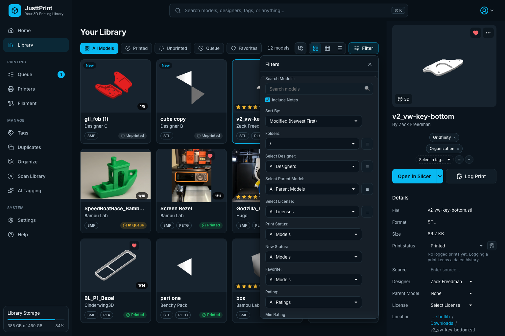
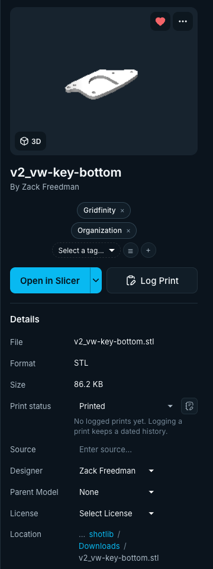
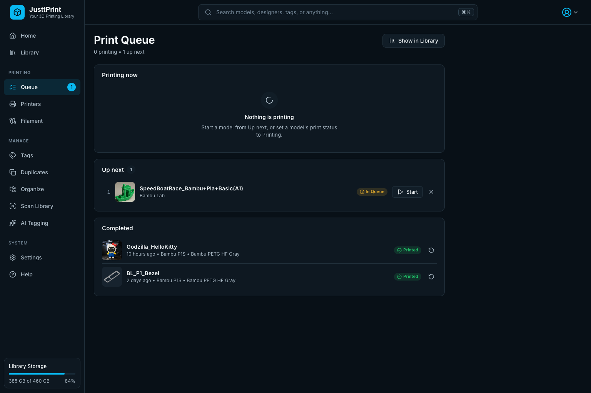
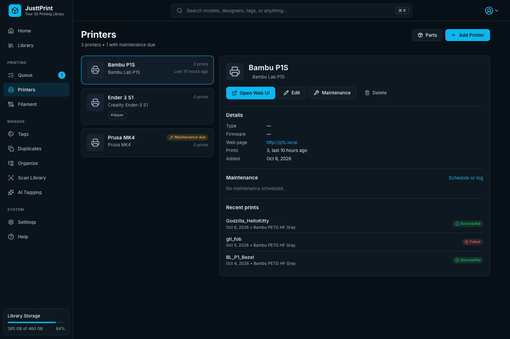
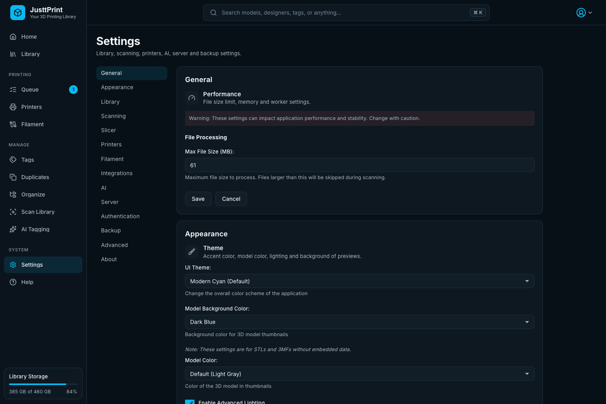

# JusttPrint Guide

JusttPrint is a self-hosted web app for your 3D printing model collection. It runs in Docker, and you use it from any browser on your network: computer, tablet or phone. This guide shows how to use it; [README.md](../README.md) covers installing and setup.

## Finding your way around

The sidebar on the left holds every page:

| Section | Pages |
|---------|-------|
| (top) | **Home**, **Library**, **Collections** |
| Printing | **Queue**, **Printers**, **Statistics** |
| Manage | **Tags**, **Duplicates**, **Organize**, **Scan Library**, **AI Tagging** |
| System | **Settings**, **Help** |

The top bar has the search box (**Ctrl/⌘ K** focuses it from anywhere) and the account menu, which shows who is logged in (**Change Password**, **Log Out**, and for admins **Users** and **JusttPrint Backend Access**). Each person sees only the pages their role can use (see [Users and roles](#users-and-roles)). **Library Storage** at the bottom of the sidebar shows how full the disk holding your models is; scan and thumbnail progress appear just above it while they run.

On a **laptop** screen the details panel opens as a drawer from the right. On a **tablet** the sidebar shrinks to icons. On a **phone** a bottom bar holds Home, Library, Queue, Printers and **Menu** (the full sidebar), cards show two per row, and the details fill the screen.

### Install it as an app

**Settings → Install App** (also under **Help**) adds JusttPrint to your phone's home screen or your computer's apps. It then opens from its own icon, full screen without the address bar. It is still the same JusttPrint in your Docker container; nothing is copied to the device.

- **iPhone and iPad:** in Safari, tap **Share**, then **Add to Home Screen**. Works over plain `http://` too.
- **Android, Windows, Mac, Linux (Chrome or Edge):** click **Install JusttPrint** in the dialog, or choose **Install app** in the browser's menu (⋮). These browsers install apps only over **HTTPS with a trusted certificate**; over plain `http://` you get a shortcut that opens in the browser instead.
- **HTTPS for installing:** the easiest way is a reverse proxy with a certificate (for example Nginx Proxy Manager, Caddy, Traefik or Tailscale HTTPS) in front of JusttPrint, or Let's Encrypt in **Settings → HTTPS / SSL** when JusttPrint has a public domain name. A self-signed certificate is not enough for Android: the browser does not trust it.
- **Firefox** does not install web apps; add a bookmark.

On a touch screen, buttons that appear on hover with a mouse (a card's heart and **…**, the small buttons beside the details fields) are always shown, and controls are larger so they are easy to tap.

## Getting started

1. Start the container, open `http://<docker-host-ip>:5000` and log in as `admin` with the `JUSTTPRINT_PASSWORD` password (or the one printed in `docker logs`).
2. Choose your models folders: while none is set, JusttPrint asks after you log in (**Choose your model folders**: tick the suggested folders, or **Add another folder…**, then **Scan**). Later, change them under **Settings → Scanning → STL Home** (or upload models, see [Uploading models](#uploading-models)): **Browse…** shows the folders mounted into the container (such as `/mnt/models`), or type the container path. JusttPrint scans it right away, watches it so new and deleted files show up within seconds, and scans it again on a schedule (every 60 minutes unless you change it) for anything watching misses, such as changes on a network share. **Scan Library** in the sidebar scans again at any time.
3. Thumbnails are rendered in the background; you can use the library while they appear.
4. Optional: pick light or dark under **Settings → Appearance → Theme**, set up **AI Tagging**, add your slicers under **Settings → Slicer** and your printers on **Printers**.

**Help → Quick Start Guide** shows a short tour in the app.

## Home

Home greets you with tiles, each shown when it has something to say: **Your library** (models, printed, in queue, printers; click one to open it, with a render of the model you printed last), **Needs you** (queued prints short of filament, maintenance due, nearly empty spools; click one to go there), **Spools** (grams on hand and the fullest spools), **Up next** (the next queued print and whether your spools cover it), **Printing now** (with Log Print), **New in your library**, **This month** (prints, how many worked, filament used, prints per week) and **Printers** (what each has loaded, or maintenance due). Then **Recent Activity** (logged prints and newly added models) and the models added most recently.

Below them, when there is something to show:

- **Continue your kits:** kits with some parts printed and some not, with their progress; a click opens the kit. With **Folders as models** on, a folder of two files or more is a kit; otherwise a 3MF with several plates is.
- **Needs attention** (editors and admins): automatic backups that failed or are late, printers with maintenance due, uploads not organized yet (with **Organize**, see [The Upload folder and Organize](#the-upload-folder-and-organize)), identical files, and models without a category, tags, a license or a thumbnail. Click one to go where it is fixed, such as the library showing just those models.
- **Favorites**, your **Collections** (the most recently changed) and **Browse by category** (a click shows that category's models).

## Library

The library shows your models as cards: preview, name, designer (or folder), file type, print status and, once you have spools, **Ready to print** or what it needs, with the colors it needs as dots (a ringed one is short). Hover a card for **Favorite**, **More** (the model menu) and the star rating.

- **Categories**: the categories that have models, as tabs; choose one for its models and its subcategories under it, **All** for every model.
- **Banners** (the whole library): **Printable right now** shows only the models your spools cover (click again for all), **New this week** the models added in the last 7 days.
- **Fits my filament** (next to the tabs, once something fits) shows only what you can print with the spools on hand.

- **Tabs**: **All Models**, **Printed**, **Unprinted**, **Queue** (queued or printing) and **Favorites**. The count next to them is the number of models shown.
- **Views**: **Grid** (cards), **Wall** (large previews only; the tile size is next to the view buttons) and **List** (one row per model with columns you can show, hide and resize).
- **Folders**: the folder button opens a folder panel beside the grid; click a folder to show only its models.
- **Selecting**: click a card to show it in the details panel. To change several models, click **Edit** next to **Filter**, Ctrl/⌘-click a card, or Shift-click: a Shift-click chooses every card from the one you clicked last to this one. See [Edit mode](#edit-mode). The arrow keys move the selection, Ctrl/⌘ A selects everything shown.
- **The model menu**: the **⋯** button on a card (or the Menu key, Shift+F10, or a long press on a touch screen) for Open in Slicer, 3D preview, move, rename, remove, Generate Tags and more. **Delete from Disk** is for admins and the editors an admin allows.
- **Print status**: **Log Print** in the details panel logs a print; its **Print status** picker changes the status without logging.

### Search and filters

Type in the top bar to search names, designers, tags and (optionally) notes. **Filter** opens every filter: folder, designer, title, license, tags, print status, new models, favorites, rating, file type and sort order. Active filters show as chips under the tabs; click a chip's × to remove one, or **Clear all**.

### Folder bundles

When a scan finds two or more model files in the same folder, they show as one **bundle** card.

| Action | Result |
|--------|--------|
| Click the bundle | Expand or collapse its files in the grid, and show the bundle's details |
| Right-click → **Preview** | 3D preview with every part laid out side by side (up to 32 parts) |
| **Send to Slicer** (in the preview) | Sends every part to your slicer |

Single files in a folder are not grouped.

### Merged models

Models that belong together (a set, a kit, a multi-part print) can be **merged** into one: the library shows one card, the main model's, and its page lists every model merged into it, each with its 3D view, **Open** and **Download**. A merged model's own page says what it is merged into, with **Un-merge** to make it a model of its own again. Merge models in [Edit mode](#edit-mode); model files uploaded on a model's page, and the extra files of a model downloaded from a link, are merged into it by themselves. Merging changes no files.

## Model details

A model's **Title** is the name cards and its page show instead of its file name (hover over a card's name for the file's). A 3MF's own title fills it when the model is added (**Settings → Scanning → File Types → 3MF Metadata**), and you change it in the details, **Edit** or Multi-edit. Search, the **Title** filter and sort, Organize Library's folder levels and the Metadata Manager use it too.

A model's own page (**Open** on its card) also has **Print this model** at the top of the side column, once its filament is known and you have spools: choose all plates or one (with their grams), see which spool gives each color and what is left or short, see which printers already have the colors loaded (or how many spools to swap), and **Add to queue** with that plate and printer, or **Log a print**.

Click a model to see it in the details panel, which shows the sections of its page in one column:

- **Name, designer**, and the model it is merged into, if it is.
- **Pictures**: click one for full size (or **3D** for the 3D preview); the strip underneath has the others.
- **Model Details**: **Open in Slicer** (the arrow lists the other slicers), **Edit**, **Log Print** and **Open Page**, then file, format, size, print status, rating, designer, source, license, tags, Category, Subcategory, location and date added.
- **Description**, the site's section (for models from MakerWorld, Printables or Thingiverse), **Videos**, **Documents**, **Notes** (edited in place), the other files in its folder, kit progress and **Print History**.

On a model's own page (**Open Page**) editors and admins change things in place too: the print status from its menu, tags with × to remove and **Add a tag**, and a print removed from **Print History** with its bin button.

### Edit mode

Click **Edit** next to **Filter** above the grid (or press Ctrl/⌘ E). A click on a card now chooses it instead of opening it:

- **One model**: its details in the sidebar, with **Edit** for the Edit dialog.
- **Two or more**: the **Multi-edit** panel. **Merge…** at the top merges them into one of them (pick the main model). Changes there apply to every chosen model as soon as you make them: print status, source, designer, title, license, Category, and adding or removing a tag. **Log a Print on Selected** records one print for all of them. **Delete** at the bottom deletes every chosen model, after asking: **Delete from Library** takes them out of the library and keeps their files, moved to a `.JusttPrint Trash` folder at the top of their library folder (for example `/mnt/user/.JusttPrint Trash/…`, the same path inside it), which no scan looks in, so they do not come back (move them out of it by hand to bring one back, then scan); **Delete from Disk** deletes the files for good (admins, and the editors an admin allows). A model folder whose models are all chosen goes as a whole, with its pictures and documents, and a model inside a ZIP takes its whole ZIP.
- **Collections** adds every chosen model to a collection, or to a new one (＋).

**Done** (or Escape) leaves Edit mode.

### Print status and history

Each model has a status (Unprinted, Want, Queued, Printing, Printed, Failed) and a print log. Logging a print (date, outcome, quantity, printer, parts used, notes) sets the status and adds a dated entry to the history; a successful print counts as a reprint after the first. The **Printed** and **Unprinted** tabs go by the logged prints, not the status alone. For a 3MF with several plates, **Log Print** lists them: a Printed print ticks only the plates you leave ticked in the model's kit, and its notes say which.

## Printing

- **Queue** lists **Printing now**, **Up next** and **Completed** (recent successful prints; ↻ queues one again). Up next is in the order you print: the arrows move an item, and each item can be one plate of a 3MF and one printer. Each says **Ready to print** or what it needs (**Filament** shows which spool gives each color and what is left), counting what the prints before it will use. **Start** moves an item to Printing now, the copy button queues another, × takes it out. Setting a model's status to Queued anywhere adds it at the end; logging a print finishes one of its items. **Home** shows what is up next.
- **Printers** keeps your printers: make and model, type, firmware, print count and last print, and what is loaded in them (rings on each printer). On a printer's page, **Filament loaded** shows its AMS units and its own holder: click a slot to load a spool from the Filament page (one loaded elsewhere moves) or **Empty it**; **Add AMS** adds a unit with four slots, and **Rename**, **Humidity** and the bin manage one. The printer form also keeps the connection (Bambu Lab, Moonraker, OctoPrint), serial number, address and access code or API key; the code stays on the server. Admins can **Import from Bambu Lab**: the printers on the Bambu Lab account signed in under Settings → Integrations → MakerWorld are added (with an AMS) or brought up to date. Select one for its web page (**Open Web UI**), maintenance reminders and log, and recent prints. **Add Printer**, **Edit** and **Maintenance** open the printer forms; **Parts** opens the Parts Manager (screws, bearings and other stock that logged prints use up).

### Filament

**Filament** in the sidebar keeps the spools you own and how much is left on each, shared by everyone on the library. **On hand** adds up the grams of every spool that is not archived, with your colors and materials; **Dryer** shows what is drying and how long it has left.

- **Add from catalogue** searches about 27,000 filaments (brand, material, color: *bambu pla basic black*) from [3dfilamentprofiles.com](https://3dfilamentprofiles.com); choosing one fills in the spool form, with the spool's empty weight when the catalogue knows it. **Add by hand** starts from an empty form.
- **Import from Spoolman** reads a Spoolman export (JSON, or what Spoolman's `/api/v1/spool` returns): vendors become brands, filaments become filaments, locations become places. Importing the same file again skips the spools already here.
- Click a spool for its details. **Weigh** it on a kitchen scale: on its spool (enter the empty spool's weight under **Edit** first) or the filament alone; JusttPrint works out what is left and keeps every weighing. **Dry** starts a drying session (temperature and time come from the filament when it has them); **Finish drying** ends it, with the humidity after if you measured it. **Move** puts it in a place (a shelf, a dry box), **Archive** keeps a used-up spool for your records and takes it out of every printer, **Delete** removes it.
- **Places** lists your shelves and dry boxes. The chips above the spools show those running low (under 300 g), drying, of one material, or archived.

Viewers see the spools; editors and admins change them.

**Running low.** A spool is low, then critical, when its share left falls under a rule's line: 20 % and 10 % until you set your own under **Settings → Printers → Alerts & webhooks** (a rule can be for one material, and send to Discord or email too). JusttPrint tells each spool once, as a notification (and again if it turns critical); weigh or refill it and it starts over. The **Reorder** tile lists them; **Open shopping list** shows each with its shop, the price you paid and **Buy again**, and **Copy the list** puts it on the clipboard. **Check now** in the settings checks at once instead of within the hour.

**Labels.** **Labels** prints a sticker per spool with a QR code: choose the spools and a size (40×30, 50×30 or 40×12 mm), then **Print**. Scanning the code opens the spool on the Filament page (log in on the phone first).

**Coming from FilamentHub?** Admins: **Settings → Integrations → Import from FilamentHub**, then choose `filamenthub.db` from FilamentHub's data volume or one of its backup ZIPs. **See what comes in** lists, per kind, how many are in the file and how many are new, and which JusttPrint account each FilamentHub user becomes (a matching name, or a new account with a random password: set one under Users). **Import** brings them over: spools and filaments, places, weighings, drying, printers with their AMS, logged prints of files in your library, low-stock rules, webhooks, and the email and Discord settings when you have none yet. Projects, print photos and API keys are left out. Importing the same file again adds only what is new. (FilamentHub's JSON export is a Spoolman file: use **Import from Spoolman** for it.)

**Webhooks** (admins, same settings): each address gets a JSON POST when a spool runs low, a print is logged or models are added (tick the events, or none for all). With a secret, the request carries `X-JusttPrint-Signature: sha256=…`, the HMAC-SHA256 of the body with the secret, so the receiver can check it came from JusttPrint. **Send test** posts a test event and shows what the address answered.

**Ready to print.** JusttPrint reads what each 3MF's plates need, in the background (a progress bar shows while it reads): a file sliced in Bambu Studio or OrcaSlicer gives each plate's colors, materials and grams; an unsliced project gives the colors its objects use (all of them when it is painted), without grams; a model saved from MakerWorld whose file says nothing uses its print profile. Each color is matched to a spool of the same material and a close color. Once you have spools, cards say **Ready to print** or **Need black** (the colors you are short of), and **Fits my filament** in the filters shows only the models you can print now.

**Log Print** on one model has **Filament used**: a spool and the grams per copy for each color the ticked plates need, filled in from that check (spools loaded in the printer you choose come first). Change a spool or the grams, remove a row or **Add a spool**; saving takes the grams off the spools, and deleting the logged print puts them back.

### Statistics

**Statistics** in the sidebar shows what your print log says over the last 6 or 12 months, 2 years or all time: how many prints, the success rate (printed out of printed and failed; cancelled prints are counted on their own), failed and cancelled prints, and the models added. **Prints per month** stacks printed, failed and cancelled prints per month; point at a month for its numbers, or **Show table** for all of them. Below: the designers, models and printers printed most. Everyone can open Statistics.

**Filament used** counts the grams your logged prints took off your spools (prints logged with their spools), per month, and the models, printers and materials that used most. The cost is each print's grams at its spool's price (price over the grams the spool held when new); spools without a price add grams but no cost. Admins choose the currency under **Settings → Printers → Filament settings**; prices, the shopping list and what your spools are worth show in it. Amounts are not converted.

## Uploading models

Editors and admins can add models from the browser:

- Drop model files anywhere on the page, or click **Upload** in the Library.
- **Everything goes to the Upload folder** (below): model files, ZIP, RAR and 7Z files, each upload in a folder of its own. There is no other folder to choose; without an Upload folder, **Upload** opens **Settings → Scanning → Organize** to set it first (or set `JUSTTPRINT_UPLOAD_FOLDER` in Docker). Files added with **Upload** on a model's own page, and **New Version**, still go into that model's folder: **Upload** there takes any file (or drop files on the page) and puts pictures, videos and documents into their folders, model files beside the model's files and anything else into its `other` folder (**Other Files** on the page). A model without a folder of its own is given one first, after asking.
- **An archive is one model**: a ZIP, RAR or 7Z file is added to the library as itself, never unpacked or opened (no 3D preview; download it to see what is inside). The Max File Size does not apply to archives.
- Files of a type the library does not scan are skipped before anything is sent (turn more types on under **Settings → Scanning → File Types**), and so are files over the size limit (2 GB unless `JUSTTPRINT_MAX_UPLOAD_MB` says otherwise).
- Big files are fine: they go in pieces, with how much has arrived under the progress bar. A piece that fails is sent again; if the connection stays lost, the file shows an error, and **Upload** (or adding the same file again, even after reloading the page) continues where it stopped. Unfinished uploads are deleted after a day.
- Scans skip files over the size limit under **Settings → Scanning → File Size** (50 MB unless changed). The dialog warns about such files: they are saved, and appear once an admin raises the limit and scans again.
- Nothing is replaced: when a name is taken, the upload is saved as `Name (2).stl`.
- After the upload, the folder is scanned, so the models appear with thumbnails.

### The Upload folder and Organize

An admin sets up Organize under **Settings → Scanning → Organize**:

- **Scanned directory** (the Upload folder, for example `/upload`; made if it is not there yet): uploads go there first, and its models show in the library right away with a **Not organized** badge. **Not organized** in the Library's header shows just them; Home's **Needs attention** lists them too.
- **Destination directory** (for example `/mnt/user`; empty means your first STL Home folder).
- **Folder structure**: the folder levels above each model's own folder, **Category / Subcategory** unless you change them (Designer and License are the other choices, up to four levels). The model's own folder is always last and named after its **Title**: `Destination/Category/Subcategory/Title/file`.
- **Steps**, all on unless you turn them off: **Tidy into model folders**, **Generate tags** and **Apply the suggested tags**.

**Organize** in the sidebar (also in the Not organized view, and next to the item on Home) runs at once, without a page, and puts every model in the scanned directory where it belongs:

1. Every folder there is one model, with everything in it; a model file on its own (an archive too) gets a folder named after it. Archives are never unpacked.
2. **Tidy into model folders**: its loose pictures and documents go into its **Pictures** and **Documents**.
3. **Generate tags**: the AI tags its models; with **Apply the suggested tags** they are added straight away (with **AI Tagged**), and the AI's Category comes with them. With it off, the suggested tags open for your review once the models are moved.
4. It gets a Category and Subcategory: the one its site gives it, else the AI's (when an AI service is set up under **Settings → AI Tagging**), else from the words in its names and tags, else **Uncategorized › Other**.
5. It moves to `Destination/Category/Subcategory/Title/`, with its tags, notes, history and pictures, and **its files are named after its Title**, keeping their extension (`Articulated Dragon.3mf`; `Articulated Dragon (2).3mf` when two files share it). A model without a Title keeps its file names and its folder is named after the file. A folder name already taken gets a number: `Dragon Skull (2)`.

A notice shows how far Organize is (**Stop** ends it after the model it is on), and a notification says what moved. A folder with no model files in it, or one that could not be moved, stays in the scanned directory and is listed. Without a scanned directory and destination, **Organize** opens its settings instead.

## Adding models from links

Keep track of models you have not downloaded yet: editors and admins can add Printables, Thingiverse and MakerWorld models from their links.

1. Click **Add Links** in the Library.
2. Paste the links, one per line (text around them is fine, up to 200 at a time). The list below shows each model; links already in your library, as an online model or as a file whose source is that link, are marked and skipped.
3. Click **Add**. Each model is added as an online model with its name, designer, license and picture from the site, and the link as its source (the ↗ button beside **Source** in the details opens the page).

If a site does not answer, the model is still added with a name from the link and a note to fill in the rest; a link to a model the site does not have is left out. **Stop** finishes the model being added and leaves the rest.

**Download the files** (on unless you turn it off) downloads each model into a new folder per model inside the **Upload folder**, instead of adding an online model (the same for **Download** in a model's MakerWorld, Printables or Thingiverse section). Without an Upload folder, it asks for one first. Printables and Thingiverse links list their files: model files are ticked, G-code and project files are not. A link already in your library as an online model gets its files too. Thingiverse needs your own API token: make one at thingiverse.com/developers (create an app, copy its App Token) and paste it under **Settings → Integrations → Thingiverse**; without it, Thingiverse links are added as online models.

For MakerWorld links, the same option downloads the model's print profiles, each as a 3MF (its parts, ready for the slicer); a model with several profiles lists them, all ticked, so you can leave some out. The first time, JusttPrint asks you to sign in to MakerWorld. If a model cannot be downloaded, it is added as an online model and the list says why. When MakerWorld or Thingiverse is not set up yet, the dialog says what to do and has a button to the place in Settings.

## MakerWorld, Printables and Thingiverse models

A model added from a link, or any model whose **Source** is a MakerWorld, Printables or Thingiverse link, has a section named after the site in its details. Printables and Thingiverse models show the model's details, its popularity (likes, downloads, makes, collections, comments, remixes and, on Printables, the rating), what it is a remix of, Printables' print settings (with the printer it was printed on), the files (with **Download to Library…** to tick and download them) and the video. Printables also has the model page as a PDF, and says for each G-code file what it was sliced for: printer, material, layer height, nozzle, print time and filament. Thingiverse lists its files, tags, categories and remix sources only with an API token (**Settings → Integrations → Thingiverse**); without one you get the details its model page shows. If Thingiverse refuses requests for a while (a Cloudflare browser check), the section says so and keeps the details it had. MakerWorld models have the most:

- **The model**: title, English title, model number, designer (opens their MakerWorld page), license, categories, tags with their English names, dates and description.
- **Print profile**: the profile's name, printer, the size of the job (plates, grams, hours), whether it needs an AMS, its rating, **Plates** (each plate's time and grams) and the filament by material, color and grams. Models with several profiles get a list to pick from.
- **Files**: each file with its English name and size.
- **Video**: the model's YouTube video, loaded only when you press **Play video**.

**Refresh** (the round arrow) gets the details again; otherwise they are kept for a day.

Many models have several print profiles: the parts of a kit (Foot, Body, Wings…) or versions for other printers. When you add the link (or use **Download to Library…**), JusttPrint lists them with every one ticked: untick the ones you do not want, and only the ticked ones are downloaded, each as its own 3MF in the model's folder. **Downloaded profiles** in the MakerWorld section lists them with their plates, weight and print time; **Open in Slicer** next to a profile sends that one to your slicer.

**Download to Library…** (editors and admins) picks a library folder and a print profile, and saves the profile as a 3MF project: every part on its plates, ready for the slicer. It goes into a new folder named after the model, is named after the model too (its English title, else its title), then shows up in the library with the designer, license and MakerWorld link filled in. The online model becomes the downloaded 3MF (it keeps the tags, notes, rating, collections and print history), so the model is not in the library twice. MakerWorld only lets a browser download the separate files (it asks you to prove you are not a robot), and sometimes asks the same before a 3MF. Then download on MakerWorld in your browser and use **Add Downloaded Files…** in the same dialog: the files go into the model's folder and become this model. After a robot check, JusttPrint waits 30 minutes before asking MakerWorld again. MakerWorld only gives files to signed-in accounts: the first time, JusttPrint asks you to sign in with your Bambu Lab account. Bambu Lab may email a code to enter next. The sign-in is kept on the JusttPrint backend for everyone; your password is not kept.

**Settings → Integrations → MakerWorld** shows who is signed in (**Sign In**, **Sign Out**) and who makes the English file names: a free translation service (MyMemory, the default), the AI service from AI Tagging, or nobody.

## Notifications

The bell at the top right collects what happened in the background while you were not looking, with a number for the ones you have not seen:

- new models found by a scan or by folder watching (once things are quiet for two minutes, so a big copy is one notification)
- **Generate Missing** or **Regenerate All** thumbnails finished, or stopped with an error (editors and admins)
- AI tagging of several models finished (editors and admins)
- the same-geometry search on Duplicates finished (editors and admins)
- printer maintenance that is due or overdue, once per reminder (editors and admins)
- an automatic backup failed, or the thumbnail renderer could not start (admins)

Opening the bell marks them read for your account, in every browser; a notification with a page opens it when clicked. JusttPrint keeps the newest 200 for 30 days. Guests have no notifications.

## Undo

After you change a model's designer, title, license, source, notes or tags, a notice at the bottom of the page says what changed: click **Undo** to put it back. It works for multi-edit too (for example "Added tags to 12 models"). **Ctrl/⌘ Z**, when you are not typing in a field, undoes your last 20 edits one by one, newest first. Rating, favorite and print status are a click to change back, so they are not in the list.

Renaming, merging and deleting a tag (in the Tag Manager or on the Tags page) can be undone the same way; the Tag Manager shows its own **Undo** line, since the notice is behind it. Undoing a delete or a merge puts the tag back on the models that had it. The same goes for the **Metadata Editor** (renaming, merging and clearing designers, titles and licenses): it has its own **Undo** line too, and undoing a merge or a clear puts the old name back on just the models that had it.

Undo respects other people's work: undoing a tag edit takes back only the tags you added or removed, and if someone changed a field after you, you are asked whose value stays. Undoing a Metadata Editor change leaves models whose value was edited since.

## Several people at once

Everyone who has JusttPrint open sees changes as they happen: when someone edits a model, logs a print or changes its status, its card and the details panel update in every other browser (the details panel waits while you are typing in it).

If two people edit the same field of the same model, nobody's work is lost silently. When you save a designer, title, license, source or notes that someone else changed after you started, JusttPrint shows both versions: **Keep Mine** or **Keep Theirs** (for notes also **Keep Both**, theirs then yours). Tags never clash: what each person added or removed is kept.

## Collections

A collection groups models from any folders: a project, a gift list, the spare parts for one printer. A model can be in several collections, and stays where it is on disk.

- **Add to Collection…** in a model's menu (**…** on a card) adds it, or every selected model, to the collections you tick; **Create and Add** makes a new one on the spot. A dash means some of the selected models are in that collection already.
- **Collections** in the sidebar shows them as cards with a picture of the latest model added. Open one to see its models; click a model to show it in the Library, or **×** to take it out of the collection.
- **Rename**, **Description**, **Share** and the bin (delete) are at the top of a collection. Deleting a collection keeps the models and turns off its share links.

Everyone can look at collections; editors and admins make and change them.

## Sharing

**Share…** in a model's menu, or **Share** on a collection, makes a read-only link to send to someone without an account:

- Choose whether the files may be downloaded, and when the link expires (never, or after 1 to 90 days). STL and 3MF models get a **3D view** button on the page to turn and zoom them; on a view-only link only if you tick **Show STL and 3MF models in 3D** (the model's shape then reaches the visitor's browser, so a determined visitor could save it). **Create Link** shows the link and its QR code: **Copy Link**, or **Save QR Code** to print it.
- The page shows the name, pictures, designer, license, tags and source link of each model, and the collection's description. It never shows notes, file locations or print history. A shared collection also shows the models added to it later.
- Anyone with the link can open it, as long as they can reach your JusttPrint backend; to share outside your network, JusttPrint must be reachable from the internet (use HTTPS).
- The Share dialog lists the links to that item; **Settings → Sharing** lists every link with how often it was opened. The bin or **Turn Off** ends a link at once.

## Users and roles

An admin adds people under **Settings → Authentication → Users** with a user name, a password and a role:

| Role | Can |
|------|-----|
| Viewer | Browse, search, preview, download, open in a slicer, see Statistics |
| Editor | Also edit models, tags, notes and the print log, upload and add links, move, trash and delete files, scan, find duplicates |
| Admin | Also every setting, backups and restore, Organize, AI setup, HTTPS, the API token and the user accounts |

Change a role with its menu; **Set Password** gives someone a new password and logs them out everywhere; **Delete** removes the account. There is always at least one admin, and the `JUSTTPRINT_PASSWORD` account stays an admin. Everyone changes their own password from the account menu. Each person keeps their own display preferences: grid or list view, sort order, columns, panel widths, the folder panel, and light or dark (**Color Scheme**: Light, Dark, or Match the system, which follows your computer's setting; **Settings → Appearance → Theme**). New users start with the JusttPrint backend's current ones. Everything else under Settings, including the thumbnail colors, is the same for everyone. Viewers see the details panel without edit controls. MCP clients use the API token, which acts as an admin.

**Guest access** (the switch under the list of users, or `JUSTTPRINT_GUEST_ACCESS=true`) lets people who open JusttPrint without logging in browse, preview and download like a Viewer. Guests keep no settings, cannot edit, and find **Log In** under the account button; the login page offers **Browse as a guest**. Anyone who can reach the JusttPrint backend gets in, so leave it off if it is reachable from the internet.

## Managing the library

- **Tags** lists every tag with how many models use it. Create, rename (renaming onto an existing tag merges the two), delete, or show a tag's models.
- **Duplicates** finds identical files by their contents and shows each group side by side. **Look for: Same geometry** finds the same model saved as different files instead (an STL and its 3MF, a re-export, a copy turned on the plate); JusttPrint reads each STL and 3MF once for it, and mirrored left and right parts are not matched. **Look for: Same shape, any resolution** also finds the same design exported with more or fewer triangles (a smooth and a coarse STL of one part); since a part a few percent bigger, or one that differs only in small details, looks the same to it, check those groups before deleting. **Keep this** marks the other copies for deletion; **Select the extra copies** keeps one copy of each group for you (preferring the folder you choose under **Keep the copies in this folder**). Nothing is deleted until you confirm **Delete Selected**. You can limit the search to the models currently shown.
- **Organize** puts the models in the scanned directory (the Upload folder) into `Destination/Category/Subcategory/Title/`, their files named after the Title, then tags them; see [The Upload folder and Organize](#the-upload-folder-and-organize). The models folder must be mounted without `:ro`.
- **AI Tagging** sets up the AI service; then choose models with **Edit**, open a chosen card's **⋯** menu and choose **Generate Tags**, and tick the tags to keep. See [AI tagging](#ai-tagging).
- **Settings → Library** has the Metadata Manager (rename or remove designers, licenses and titles everywhere), Library Stats, Print Roulette (random models to print), Clear New Flag and Purge Models.

## AI tagging

AI tagging looks at a model's thumbnail, name and folder names and suggests tags. You review them before they are saved.

1. Click **AI Tagging** in the sidebar.
2. Pick a service: OpenAI, Claude or Gemini need an API key; **Puter** signs in to your Puter account instead; **custom** works with a local OpenAI-compatible server such as Ollama or LM Studio (no key).
3. Pick a model and the tagging options (number of tags, replace / merge / append, categories, detail level), then save.
4. Choose models with **Edit**, open a chosen card's **⋯** menu and choose **Generate Tags**. **Tag from Folder** copies folder names onto the models as tags without asking the AI.

While it runs, the review fills in model by model. **Stop** skips the models not started yet (the tags already suggested can still be applied). **Run in Background** closes the review and keeps going: the sidebar shows the progress in every open browser, and **Review** there opens it again, also after you reload the page. Once you apply or cancel a finished review, its suggestions are gone. One run at a time; with **Puter** the AI runs in your browser, so keep that tab open.

Tips: start with a few models, use **merge** to keep the tags you already have, and review the suggestions before applying them.

## Settings

**Settings** is one page with an index on the left. Viewers and editors see only the few entries their role can use:

| Group | What is there |
|-------|---------------|
| General | Performance: the largest file a scan processes |
| Appearance | Theme: light or dark, and the background, model color and lighting of thumbnails |
| Library | Metadata Manager, Library Stats, View Entire Library, Print Roulette, Clear New Flag, Purge Models |
| Scanning | STL Home, Organize (the scanned directory, the destination, the folder structure and its steps), File Types (extra types, skipped folders), Scan a Folder |
| Slicer | Your slicers, and the helper for Send to Slicer |
| Printers | A link to that page, and the Parts Manager |
| Integrations | MCP Server: connect an AI app to your library |
| AI | AI tagging settings |
| JusttPrint Backend | HTTPS / SSL and the listen port, Restart JusttPrint Backend |
| Authentication | Users (admins), Change Password, JusttPrint Backend Access (the API token), Log Out |
| Backup | Automatic backups, download a backup, export the library, restore |
| Advanced | Regenerate Thumbnails, Generate Missing Thumbnails, System Report |
| About | Version, update check, license |

Most forms are shown right on the page: change the values and click **Save**.

### Send to Slicer

Slicers run on your computer, not in the JusttPrint backend. **Open in Slicer** (details panel, model menu) and **Send to Slicer** (3D preview) open the model there.

- **OrcaSlicer, no helper:** under **Settings → Slicer**, click **Add OrcaSlicer (no helper)** and **Save**. Open in Slicer then hands OrcaSlicer a link: it downloads the model from JusttPrint (into its download folder, OrcaSlicer → Preferences) and puts it on the plate, in the window that is already open. Works with OrcaSlicer 2.x on Windows and macOS out of the box; on Linux, turn on OrcaSlicer's desktop integration (AppImage) so the link opens it. Up to 1 GB per file and 10 files at a time (they arrive one after another). The browser may ask once whether to open OrcaSlicer: allow it. The computer must reach the JusttPrint backend at the address in the browser, and with HTTPS the certificate must be trusted (OrcaSlicer refuses self-signed ones; use plain HTTP on the home network, or a real certificate). Each download address works for 30 minutes and only for that file.
- **Other slicers (and OrcaSlicer with options of your own):** add each slicer with its path on your computer, then download and run the JusttPrint helper there once. On a Mac the helper opens a new slicer window for each send.

### MCP server

AI apps (Claude Code, Claude Desktop, Cursor, VS Code and others) can connect to JusttPrint at `http://<docker-host-ip>:5000/mcp` to search the library, edit tags and metadata, log prints, set thumbnails, list and set categories (`list_categories`, `set_model_category`, `categorize_library`), rename models (`rename_model`), change a model's site details (`get_site_details`, `update_site_details`), add models from Printables, Thingiverse and MakerWorld links (`import_model_links`, with an optional library folder to download the files into), and work with your filament: list and weigh spools (`list_spools`, `get_spool`, `weigh_spool`), check a model against your spools (`check_model_filament`), list what you can print now or on one printer without swapping spools (`what_can_i_print`), see the reorder list (`get_reorder_list`), see and add to the queue (`get_print_queue`, `add_to_queue`), get filament used and its cost (`get_filament_stats`), and log a print with the spools it used (`log_print_event` with `spools`). **Settings → Integrations → MCP Server** shows the setup for the app you pick, with the address and API token filled in. Anyone with the token can read and change your library.

## Keyboard

**Help → Keyboard Shortcuts** lists them all. The main ones: **Ctrl/⌘ K** search, **Tab** moves between cards (each card is one stop), **Enter** or **Space** selects, the arrow keys move the selection, **Ctrl/⌘ A** selects all, **Ctrl/⌘ E** Edit mode, **Ctrl/⌘ Z** undoes the last edit, **Escape** closes a dialog, drawer or popover. A **Skip to content** link is the first Tab stop on every page.

## Your data

- The database, thumbnails and settings live in the container's data folder (`/root/.config/justtprint`); mount it as a volume so it survives updates.
- A backup copy (`backup_justtprint.db`) is written every time the JusttPrint backend stops.
- **Settings → Backup → Automatic Backups** copies the database on a schedule (every day unless you change it) and keeps the newest copies (7 unless you change it). They go to `backups` in the data folder, or to a folder you choose with **Browse…**; a folder on another disk also protects against a disk failure. Each backup in the list can be downloaded or restored.
- **Settings → Backup** also downloads a backup by hand or restores one from a file. Keep a backup before removing the container or its data volume.

## Tips

- Use tags, designers and titles consistently; the Metadata Manager and the Tags page clean them up later.
- Generate Missing Thumbnails is much faster than regenerating all of them.
- Check **Duplicates** now and then, limited to the models in view for a large library.
- Print Roulette (**Settings → Library**) finds forgotten models worth printing.
